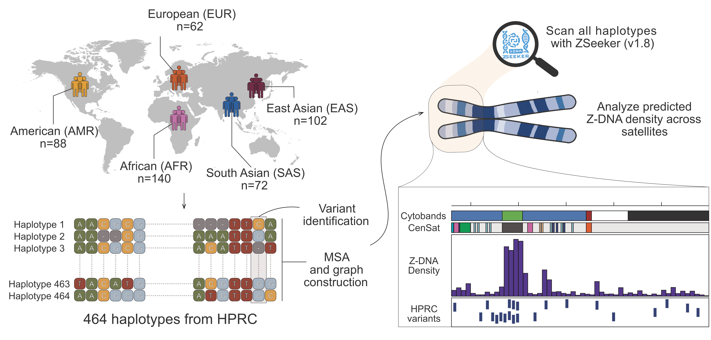

# Genomic variation associated with Z-DNA in the human pangenome

  

Code for the analyses in *Genomic variation associated with Z-DNA in the human pangenome*
(Megalovasilis et al., manuscript under revision).

We predicted Z-DNA-forming sequences with [ZSeeker](https://github.com/Georgakopoulos-Soares-lab/ZSeeker) v1.8
in 464 haplotype-resolved assemblies from HPRC Release 2 and in the T2T-CHM13v2.0, GRCh38.p14 and GRCh37
reference genomes. We describe their distribution across human genomes and compare genetic variation at
predicted Z-DNA with composition-matched control sequences, using 52 million HPRC variants and more than
250,000 de novo mutations.

## Repository contents

| File | Description |
|---|---|
| `Z-DNA_instability_human_pangenome_analysis.ipynb` | Annotated notebook with every analysis, figure, table and Supplementary Data 1 |
| `docs/workflow.png` | Study overview (Fig. 1a) |

## Data

ZSeeker predictions for all 467 genomes and the HPRC sample metadata: https://doi.org/10.5281/zenodo.24204926

| Resource | Source |
|---|---|
| HPRC Release 2 assemblies (464 haplotypes, 232 individuals) | https://github.com/human-pangenomics/hprc_intermediate_assembly |
| HPRC Release 2 Minigraph-Cactus variants (T2T-CHM13 coordinates, vcfwave) | `hprc-v2.0-mc-chm13.wave.vcf.gz`, https://42basepairs.com/browse/s3/human-pangenomics/pangenomes/freeze/release2/minigraph-cactus |
| T2T-CHM13v2.0, GRCh38.p14, GRCh37 | NCBI RefSeq `GCF_009914755.1`, `GCF_000001405.40`, `GCF_000001405.13` |
| T2T-CHM13 annotations (cytobands, RefSeq Liftoff v5.2, CenSat v2.1, RepeatMasker 4.1.2p1, telomeres, chrX/Y sequence classes) | https://s3-us-west-2.amazonaws.com/human-pangenomics/T2T/CHM13/assemblies/annotation/ |
| De novo mutations (GRCh37) | denovo-db v1.6.1, non-SSC samples, https://denovo-db.gs.washington.edu |

## Analysis overview

The notebook follows the Results of the paper. Numbered prefixes (`0_`–`20_`) mark the intermediate
tables each step writes.

1. **Z-DNA across human genomes** (Fig. 1, Supplementary Fig. 1a–c, Table 1): genome-wide and
   per-chromosome density over ACGT bases, assembly-specific sequences, length and score distributions,
   GC content and parent-of-origin comparison.
2. **Z-DNA in T2T-CHM13** (Fig. 2, Supplementary Figs. 1d–f and 2a, Table 2, Supplementary Table 2):
   density in 100-kb bins, cytobands, CenSat arrays and chrX/Y sequence classes; enrichment across
   annotation classes; telomere arrays; sequence composition and logos.
3. **Variants at predicted Z-DNA** (Fig. 3, Supplementary Fig. 2b–e): composition-matched controls (same
   chromosome and length, GC fraction and CpG+GpC density within 10%), normalization of the HPRC VCF,
   Z-DNA density around variants, SNV types, de novo mutations and variant frequency along Z-DNA intervals.
4. **Variant size, ZSeeker score and tract length** (Fig. 4, Supplementary Fig. 3a,b, Supplementary Table 3).
5. **Genomic context, allele frequency and indel sequence context** (Fig. 5, Supplementary Fig. 3c–e,
   Supplementary Table 4): compartment-specific rate ratios, genotype completeness, allele-frequency
   trends and COSMIC ID83-derived indel groups.

Statistics use chromosome-block bootstraps over the 24 chromosomes and Wilcoxon, Mann–Whitney,
Kruskal–Wallis and Friedman tests, with Benjamini–Hochberg correction.

## Outputs

- `tests/`: one table per figure panel (plotted values and statistics), collected into
  `Supplementary_Data_1.xlsx` by the last cell.
- `plots/`: figure panels (PDF and PNG).
- `Table_*.tsv`, `Supplementary_Table_*.tsv`: manuscript tables.

## Running the notebook

Replace the placeholder paths (`/path/to/pangenomes_zdna`, `/path/to/scratch`) with your own directories.
Steps that need an HPC cluster (genome downloads, ZSeeker runs, control generation, VCF parsing and ID83
classification) are included as commented cells; their outputs can be regenerated from the Zenodo
predictions and the public data listed above.

## Software

Bash and Python 3.9.7 with numpy 2.0.2, pandas 2.3.1, polars 1.32.3, pyarrow 16.1.0, scipy 1.13.1,
statsmodels 0.14.5, scikit-posthocs 0.11.4, pysam 0.23.3, pyfaidx 0.9.0.3, Biopython 1.85,
pybedtools 0.12.0 (BEDTools 2.31.1), logomaker 0.8 and matplotlib 3.9.4. ZSeeker 1.8 was run with
default parameters.

## Citation

Megalovasilis G., Bochalis E., Chartoumpekis D. V., Vasquez K. M., Georgakopoulos-Soares I.
Genomic variation associated with Z-DNA in the human pangenome. Manuscript under revision.

## Contact

Ilias Georgakopoulos-Soares (ilias@austin.utexas.edu)
